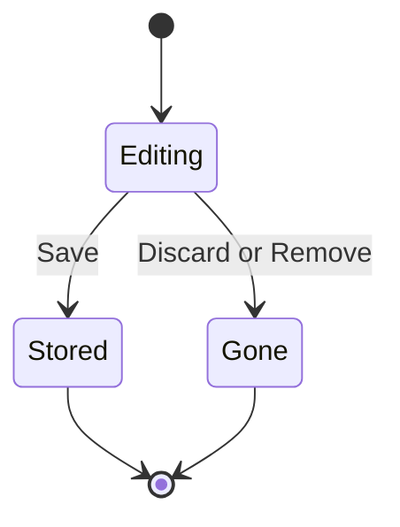
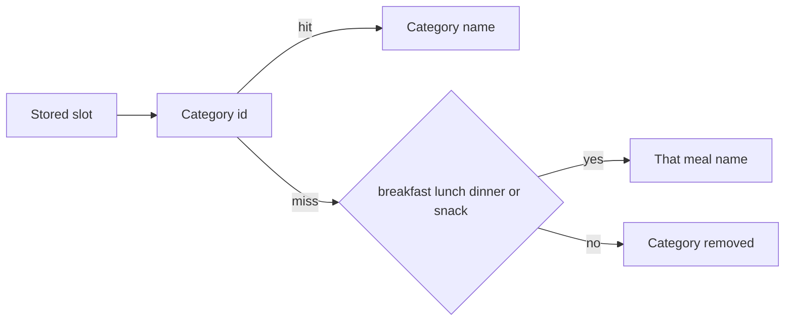

# Explicit Save and v1.1.1 UI - Plan

## Goal Capsule

**Objective:** Jason reviews a linked recipe and a meal-plan pick before either is stored, and the meal plan, shopping checklist, pantry rows, and header match the screens he marked.

**Means:** Reuse the import draft and the recipe category list, and hold the new meal card in memory until Save (KTD1, KTD3, KTD4).

**Authority:** Product behavior lives on the R-IDs. Mechanism lives on the KTDs. A test that locks the old behavior is updated in the unit that changes it.

**Stop:** Leave rating, cooked, category, and unit writes on the recipe screen immediate. Leave aisle values stored. Leave `README.md` unchanged.

**Execution profile:** One code change on a feature branch. Prove each behavior with a test, and prove the header with renders.

**Finishes and ships:** The implementation run opens the pull request. After CI is green, squash-merge and publish the v1.1.1 release the way v1.1.0 was published, because the owner asked for that in this run.

## Product Contract

### Summary

v1.1.1 stops a pasted recipe link and a new meal-plan entry from being stored until the user taps Save, takes meal-plan chips from the user's recipe categories, and removes the idle save status, the Today button, the "Added by you" line, and the aisle headers. Pantry rows show quantity beside the name. The settings gear stays on screen.

### Problem Frame

A pasted link is stored before Jason can look at it, and the recipe screen then says "All changes saved." Meal plan offers Breakfast, Lunch, Dinner, and Snack even when those are not his categories, and tapping Add to a category writes the day immediately. The checklist groups cream of mushroom soup under Produce. Pantry rows show a category under the name. The settings gear is clipped on his phone, and Meal Plan still shows a Today button he does not want.

### Key Decisions

- **Link import waits for Save.** A successful non-duplicate link stays a draft until Save. Governs R1, R2.
- **Idle "All changes saved" goes away.** Rating, cooked, category, and unit still save on change. Governs R3.
- **Chips are recipe categories.** Snack is absent unless that category exists. An old slot still shows. Governs R4, R5.
- **A new meal is stored on Save.** Governs R6.
- **The checklist titled Shopping List is one list.** Governs R9.
- **README stays as it is.** The versioning sentence still says the next release is v1.1.0. It does not describe these features, so it is not edited. Governs the scope boundary below.

### Requirements

#### Import and recipe screen

- R1. Pasting a recipe link and tapping Import link stores nothing until the user taps Save.
- R2. Leaving that screen while a non-duplicate draft is showing warns the user, who can keep editing, discard, or save.
- R3. The recipe screen does not show "All changes saved" when nothing is waiting. Rating, cooked, category, and unit changes still save immediately.

#### Meal plan

- R4. Add-a-recipe chips are the user's recipe categories, in Recipes-screen order, including empty and custom categories. There is no Snack chip unless that category exists.
- R5. A stored meal whose slot is not a current category still appears and is not deleted.
- R6. After Add to a category, the day screen shows the new card and any meals already on that day, hides the add block, and writes the new meal only when Save is tapped. After Save, the add block returns.
- R7. The Meal Plan calendar has no Today button. Today's cell stays highlighted.

#### Shopping, pantry, header, release

- R8. Shopping-list rows do not say "Added by you." A manually added row can still be edited.
- R9. The checklist opened as Shopping List is one flat list. It has no aisle or category headers.
- R10. A pantry row shows the item name and, when a quantity is stored, "Quantity: N" on the right. The row has no category, brand, expiry, or notes line. Tapping the row opens the existing editor.
- R11. The settings gear is fully visible at 360dp, at the default width, and at a font scale above 1.
- R12. The app version is 1.1.1 and the Android versionCode is 12. Release notes follow the v1.1.0 notes in the version docs.

### Key Flows

- F1. Import link. The user pastes a URL and taps Import link. An error stays on the form. A duplicate offers Open existing and does not warn on leave. Any other success shows the draft and a pinned Save. Save writes that draft, then opens it. Editing the link or the pasted text after the preview clears the draft, and Save stays disabled until Import link or Import text is tapped again. Back or another leave while the draft is showing runs the R2 warning.
- F2. Add a meal. The user opens a day, picks a category chip, and taps Add to that category. The add block disappears and the new card stays on screen. The calendar cell does not gain the meal. Save writes it and brings the add block back. Remove on the new card drops it without writing.

### Acceptance Examples

- AE1. A link that parses and is not a duplicate is absent from Recipes until Save. Covers R1.
- AE2. Leaving that draft offers Keep editing, Discard, and Save. Discard leaves Recipes unchanged. Covers R2.
- AE3. A category named "Get me laid" is a chip. With no Snack category, no Snack chip is shown. Covers R4.
- AE4. An entry stored as snack still appears when Snack is not a category. Covers R5.
- AE5. After Add to Dinner, the add block is gone and the calendar cell is unchanged until Save. Covers R6.
- AE6. Cream of mushroom soup on the checklist has no "Produce · 1 left" header. Covers R9.
- AE7. A pantry item named M&M's with quantity 2 shows that name and "Quantity: 2", and no category. Covers R10.

### Scope Boundaries

In scope: the eight screen changes, the version bump, and the version-doc notes.

Out of scope:

- Nutrition, sweetener checks, and servings writes. The recipe stepper stays display-only.
- Stopping the immediate save of rating, cooked, category, or unit on an already stored recipe.
- Deleting aisle inference, the aisle field, or `groupByAisle`.
- A second category list, a new screen, or a new gated feature.
- Editing `README.md`.
- A leave warning when the user changes meal-plan day with an unsaved card. That remount drops the card.

#### Deferred to Follow-Up Work

- Rewriting the README versioning sentence that still names v1.1.0 as the next release.
- Warning before a meal-plan day change discards an unsaved card.

### Sources

Behavior checked in `src/app/import.tsx` (`importLinkNow` commits after a dry run), `src/components/recipe-detail.tsx` (idle status "All changes saved"), `src/components/day-plan.tsx` (`MEAL_SLOTS`), `src/components/grocery-run-view.tsx` (aisle section headers), `src/app/(tabs)/pantry.tsx` (row subtitle), `src/components/app-header.tsx` (gear padding), and `src/components/meal-calendar.tsx` (`jump-today`). Category order is `groupRecipesByCategory` in `src/lib/recipe-utils.ts`, which includes empty categories. Layout and theme rules are in `LESSONS.md` and `docs/DESIGN.md`.

## Planning Contract

### Key Technical Decisions

- KTD1. Link import calls the existing dry-run preview. The pinned bar reuses Save and Save and edit, placed outside the scroll the way `recipe-save-bar` is. Save writes the preview still on screen. Changing the link or the pasted text clears that preview and disables Save until the import button is tapped again. Clear the draft after a successful write and before `router.replace`, so the leave listener does not warn for a recipe that is already stored. A failed write keeps the draft. Governs R1, R2.
- KTD2. Mount the recipe save bar only for an unsaved tag, a failed save, or a save in flight. Leave `persist` in place for rating, cooked, category, and unit. The circled idle line is this bar's empty state, not the import write. Turning off `persist` would change controls the request did not name. Governs R3.
- KTD3. Store the category id on new meal entries. Widen `slot` so a category id fits, and keep old `breakfast`, `lunch`, `dinner`, and `snack` values loadable. Resolve a chip or a label by id, then by a case-insensitive match on the legacy name. A legacy name with no matching category shows Breakfast, Lunch, Dinner, or Snack. "Category removed" is only for a stored category id whose category is gone. Call `prepareCategories` before `listCategories` so the chips match Recipes even when that tab has not been opened. The selected chip starts as Dinner when that category exists, otherwise the first category. Governs R4, R5.
- KTD4. The new meal card lives in a non-persisted session that the meal-plan tab and the day route both read, not in a store row and not only inside the day pane. Folding the window must not drop it, because the secondary pane unmounts on a phone-width layout. Save calls the existing place-entry path and clears the session. Servings and category on that card stay local. The card has no previous-day or next-day buttons, and its date stays the open day. Remove discards it. Clear the session when the open date changes. Hide "Nothing planned" while the card is showing. Already stored cards still update the store from their own controls. Ignore Add when that day already has the same recipe in that category, including a legacy slot that resolves to it. Governs R6.
- KTD5. Render the grocery checklist as one list. Remove the aisle section headers and the wide-pane "By aisle" lines. Keep the two-pane shell when it is only a width treatment. If the secondary pane's only content is the aisle summary, do not render those headers. Governs R9.
- KTD6. Change the pantry row in the screen. Leave `pantryCardText` for other callers. The name shrinks. "Quantity: N" keeps its width. Omit it when quantity is missing. Show it for 0. Do not append the unit. Governs R10.
- KTD7. Pad the tab header's right slot with the right safe-area inset, and inset the centered title so it cannot cover the gear. Apply the top inset on that header, including a side rail. Stack screens that have no gear stay as they are. Use theme tokens. Governs R11.

Storing a category id rather than the category name did not need a prototype. Categories already have ids, and a rename would orphan a stored name. Keeping the four meal names as the only stored values cannot represent "Get me laid".

### High-Level Technical Design

Import and the new meal card share one rule: the write happens on Save, and the screen can still be left.

A legacy meal slot resolves in this order.

### Assumptions

- A1. "The recipe is saved only when the user taps Save" applies to creating the imported recipe. It does not turn off immediate saves on an open recipe.
- A2. "Produce · 1 left" is the grocery-run checklist, which the app titles Shopping List. The shopping tab list is already flat.
- A3. Save and edit stays on the pinned import bar. The request added Save and did not remove Save and edit.
- A4. Changing the meal-plan day clears the unsaved card with no alert. Folding the window does not. The card is held outside the pane that unmounts.
- A5. After Save, the add block comes back so another meal can be added on the same visit.
- A6. An empty category is a chip, matching Recipes grouping, which includes empty categories.
- A7. `README.md` is left unchanged, including the stale next-release sentence.

### Sequencing

U1 is independent. U2 lands the category id before U3 holds a card that stores one. U4, U5, and U6 are independent of each other and of the meal units. U7 runs last so the version docs describe the finished behavior.

## Implementation Units

### U1. Link import waits for Save

**Goal:** A pasted link stays unsaved until Save, and leaving the draft warns.

**Requirements:** R1, R2, R3

**Dependencies:** none

**Files:** `src/app/import.tsx`, `src/components/recipe-detail.tsx`, `__tests__/recipe-core-ui.test.tsx`, `__tests__/recipe-detail-save.test.tsx`

**Approach:**

- Point Import link at the dry-run preview. Errors and duplicates stay as they are.
- Move Save and Save and edit out of the scroll into a bar pinned under the form, inside the screen frame so it clears the nav bar and stays above the keyboard.
- Add a leave listener while a non-duplicate draft is showing. Register it with the other hooks, before any early return.
- On a successful write, clear the draft before replacing the route. Keep the photo download after the recipe is stored.
- Apply KTD2 on the recipe screen.

**Execution note:** Change the test that expects Import link to save straight away so it fails while the old commit remains, then make the screen match. Do the same for the idle "All changes saved" assertion.

**Patterns to follow:** Text import preview, `recipe-save-bar`, and the recipe screen's existing leave alert.

**Test scenarios:**

- Happy path: a parsed non-duplicate URL shows the draft and does not add a recipe. Save adds it and opens the recipe.
- Happy path: Save and edit still opens the editor after the write.
- Edge: a duplicate shows Open existing, does not add a second recipe, and leaving does not warn.
- Edge: an empty URL shows the existing invalid-input error and no draft.
- Edge: editing the link or the pasted text after a preview clears the draft, and Save does not write the previous page.
- Error: a failed fetch or a failed write leaves the draft or the error on the import screen and does not navigate.
- Integration: Save then route replace does not also show the leave alert.
- Recipe screen: with no tag draft and no error, "All changes saved" is absent. Setting a rating still persists and does not show that line. An unsaved tag still shows Save and warns on leave.

**Verification:** The link test and the recipe-detail save test pass, and a stored recipe's rating still persists without a Save tap.

### U2. Meal chips come from categories

**Goal:** The add chips and the card chips are the user's categories, and old slots still show.

**Requirements:** R4, R5, R7

**Dependencies:** none

**Files:** `src/types/meal-plan.ts`, `src/storage/meal-plan.ts`, `src/lib/meal-plan.ts`, `src/components/day-plan.tsx`, `src/components/meal-calendar.tsx`, `src/app/(tabs)/meal-plan.tsx`, `__tests__/plan-shop-ui.test.tsx`, `__tests__/plan-shop.test.ts`

**Approach:**

- Apply KTD3. Put the label resolution in `src/lib/meal-plan.ts` and test it there.
- Load categories with `prepareCategories` then `listCategories`. Do not add an Uncategorized chip.
- Remove the Today button and its handler. Keep the today cell style and the hint "Tap a day to add meal plan".
- This unit may still write on Add. U3 changes that write.

**Patterns to follow:** `groupRecipesByCategory` for order, and the existing chip component. Long names wrap or shrink. They do not truncate to an ellipsis. Colors come from theme tokens.

**Test scenarios:**

- Happy path: categories Breakfast, Lunch, Dinner, and "Get me laid" render as chips in that order. Snack is absent.
- Edge: a stored `snack` entry still renders as Snack when Snack is not a category. It does not render as Category removed.
- Edge: a stored category id whose category was deleted still renders as "Category removed" and is not removed from storage.
- Edge: an entry with no slot still groups as Any time.
- Happy path: the Meal Plan screen has the hint and no Today button. Today's cell is still marked.
- Error: `placeEntry` accepts a category id and an old slot string, and a backup row with `slot: "dinner"` still loads.

**Verification:** Category-chip and legacy-slot tests pass. The calendar test no longer presses Today.

### U3. Meal add writes on Save

**Goal:** The new card is the only add UI, and the calendar receives it on Save.

**Requirements:** R6

**Dependencies:** U2

**Files:** `src/components/day-plan.tsx`, `src/lib/meal-plan.ts`, `__tests__/plan-shop-ui.test.tsx`

**Approach:**

- Apply KTD4. Hide the add heading, chips, servings field, search, and the "Nothing planned" line after Add.
- Pin Save at the bottom of the day screen while the card is pending, using the recipe save bar's placement so it clears the center + button and the nav bar.
- Keep already stored cards and their immediate updates, including their day buttons. The pending card does not get those day buttons.
- A day change clears the pending card. Do not add a warning in this unit. A fold does not clear it.

**Execution note:** Update the test that expects the card to appear in the store as soon as Add is tapped. That test should fail before the Save gate exists.

**Patterns to follow:** U1's pinned bar and the existing entry card.

**Test scenarios:**

- Happy path: Add to Dinner shows the card, hides the add block, and does not change the stored day. Save writes one entry with that category id and the typed servings, and the add block returns.
- Edge: blank or non-positive servings omits the servings override. The card uses the recipe's servings for display.
- Edge: Add for a recipe already planned in that category does nothing.
- Edge: Remove on the pending card restores the add block and writes nothing.
- Edge: changing the pending card's category or servings before Save writes those values, not the ones from the tap.
- Edge: the pending card has no previous-day or next-day button. An empty day does not say "Nothing planned" while that card is showing.
- Integration: the pending card is still available after the wide layout becomes a single pane, and it is gone after the open date changes.
- Integration: the calendar query for that day stays empty until Save, then includes the entry.

**Verification:** The day-plan UI test passes with no write before Save.

### U4. Shopping label and flat checklist

**Goal:** Manual rows lose the source line, and the checklist has no aisle headers.

**Requirements:** R8, R9

**Dependencies:** none

**Files:** `src/components/shopping-list-view.tsx`, `src/components/grocery-run-view.tsx`, `src/app/grocery-run.tsx`, `__tests__/plan-shop-ui.test.tsx`

**Approach:**

- Remove the "Added by you" text only. Keep the manual-row editor.
- Apply KTD5. Leave `groupByAisle` and the aisle field in place.

**Patterns to follow:** The shopping tab's existing flat list.

**Test scenarios:**

- Happy path: adding "2 lemons" shows the row and does not show "Added by you". The pencil editor still changes the text.
- Happy path: a checklist with produce and meat items renders in one list with no "Produce · 1 left" and no aisle section title.
- Edge: an item with no aisle still appears in that same list.
- Integration: checking an item still updates the progress count.

**Verification:** The shopping and grocery UI tests pass. `groupByAisle` tests still pass.

### U5. Pantry row shows quantity

**Goal:** The list row is the name plus quantity, and the editor still opens.

**Requirements:** R10

**Dependencies:** none

**Files:** `src/app/(tabs)/pantry.tsx`, `__tests__/pantry-ui.test.tsx`

**Approach:** Apply KTD6. Filter chips and sort stay. The editor still shows category, brand, expiry, and notes.

**Patterns to follow:** The existing row press opens `draftFor`. The name uses `minWidth: 0` and can shrink. The quantity text does not shrink.

**Test scenarios:**

- Happy path: quantity 2 renders "Quantity: 2" beside the name and does not render the category.
- Edge: a missing quantity renders the name only.
- Edge: quantity 0 renders "Quantity: 0".
- Integration: tapping the row still opens the editor, and saving a category there still persists.

**Verification:** The pantry UI test passes, and `pantryCardText` tests stay green without a behavior change.

### U6. Settings gear stays on screen

**Goal:** The gear is fully inside the header at the widths and font scale Jason asked for.

**Requirements:** R11

**Dependencies:** none

**Files:** `src/components/app-header.tsx`, `src/app/(tabs)/_layout.tsx`, `__tests__/safe-area.test.tsx`

**Approach:** Apply KTD7. Do not hard-code a color or a status-bar height. Do not shrink the gear by clipping it.

**Execution note:** This is a layout bug. Add the failing assertion on the header's right inset first, then make the header match. The sign-off is still the three renders, not the assertion alone.

**Patterns to follow:** `useSafeAreaInsets` and theme tokens. Tab labels keep `allowFontScaling={false}` where they already do.

**Test scenarios:**

- Happy path: the tab header's right container includes the right inset and horizontal padding, and the title container is inset on both sides.
- Edge: a zero inset still leaves horizontal padding so the gear is not flush with the screen edge.

**Verification:** The safe-area test passes. Renders at 360dp, at the default width, and at font scale above 1 show the whole gear, and each file was opened.

### U7. Version 1.1.1 and notes

**Goal:** The app reports 1.1.1 / versionCode 12, and the version docs describe this release.

**Requirements:** R12

**Dependencies:** U1, U2, U3, U4, U5, U6

**Files:** `app.json`, `package.json`, `package-lock.json`, `__tests__/v109-polish.test.ts`, `docs/SPEC.md`, `docs/PLAN.md`, `docs/INVENTORY.md`

**Approach:**

- Set `expo.version` to 1.1.1 and `android.versionCode` to 12. Set the package version in `package.json` and the lockfile root.
- Add a v1.1.1 section in the same places v1.1.0 has one. Update spec rows 1 and 18 so they describe Save-on-tap and the flat checklist. Do not rewrite the 1.1.0 history.
- Do not edit `README.md`.

**Test scenarios:**

- Happy path: `app.json` version is 1.1.1 and versionCode is 12, and `softwareKeyboardLayoutMode` is still `resize`.

**Verification:** The version test passes. Spec rows 1 and 18 no longer say the link saves straight away or that the checklist is grouped by aisle.

## Verification Contract

Run `npm test`, `npm run lint`, and `npm run typecheck`. All three pass.

Render the Recipes header, the import draft with Save, the meal-plan day after Add, the flat checklist, and a pantry row at 360dp and at the default width. Render the header again at a font scale above 1. Open every screenshot and confirm it is the screen, not an error overlay.

`__tests__/recipes-first.test.tsx` and `__tests__/entitlements.test.tsx` stay green. No new feature id is required.

## Definition of Done

- R1 through R12 are true, and the unit tests named above cover them.
- The idle string "All changes saved" is gone. Rating, cooked, category, and unit still save without an extra tap.
- Legacy meal slots and a deleted category still show. Snack is not invented.
- Aisle values remain on shopping items. The checklist does not show aisle headers.
- The gear is fully visible in the 360dp render, the default-width render, and the font-scale render.
- Version is 1.1.1 and versionCode is 12. `README.md` has no diff.
- `npm test`, `npm run lint`, and `npm run typecheck` pass.
- Abandoned code from a discarded approach is not in the diff.
- New lessons are in `LESSONS.md`, and the pull request lists them under Lessons learned.

## Risks & Dependencies

- The leave listener sees `router.replace` as a leave. KTD1 clears the draft first so a successful Save does not warn.
- The wide meal-plan layout remounts the day on a cell tap, and folding unmounts the secondary pane. The unsaved card lives outside that pane. A date change still clears it. That is A4, not a warning.
- `__tests__/v109-polish.test.ts` currently expects 1.1.0 and versionCode 11. U7 updates it.
- Spec row 18 says the grocery run is grouped by aisle. U7 updates the row so the docs match the flat list.
- A long category name on a chip can overflow at 360dp. The chip wraps or shrinks, per `LESSONS.md`.
- Optional meal plan, shopping, and pantry stay behind their existing gates. This work adds no entry point that skips a gate.
